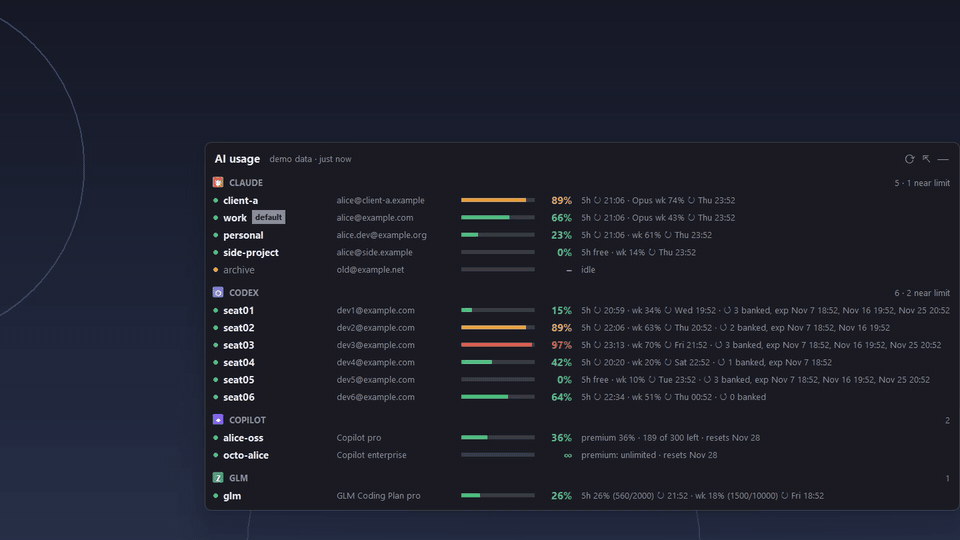

# AI Usage Widget

A tiny always-on-top Windows widget that shows how much of your AI coding plans you've used —
**Claude Code, OpenAI Codex, GitHub Copilot and the GLM Coding Plan** — across **every account** on your machine.



- **Every account at once.** Multiple Claude Code config folders, multiple Codex homes, multiple Copilot logins.
- **The limits that matter.** 5-hour session windows, weekly limits (including model-scoped ones), reset times,
  Codex banked resets with their expiry dates, Copilot premium requests, GLM credit windows.
- **Login status.** Green = active, amber = token expired (open that CLI once), grey = not logged in.
- **Two layouts.** A dock on the right screen edge (drag it up/down, minimize it to a slim handle) or a
  floating pill you drag anywhere that opens into a card.
- **Light.** One process, ~45 MB, ~0% CPU when idle. Pure Python standard library — nothing to `pip install`.
- **Private.** Read-only, local, no telemetry. See [Privacy](#privacy).

## Requirements

- Windows 10/11
- Python 3.10+ (from python.org; includes tkinter)
- The CLIs you want to track, already logged in: Claude Code, Codex CLI, GitHub Copilot CLI + GitHub CLI (`gh`)

## Run it

```powershell
git clone https://github.com/iadanish/ai-usage-widget
cd ai-usage-widget
pythonw usage_widget.pyw            # starts docked on the right edge
```

| Option | What it does |
|---|---|
| `--dock` / `--float` | start in dock or floating mode (otherwise: the mode you used last) |
| `--mask` | show emails as `a•••@e•••.com` (screen sharing) |
| `--demo` | made-up accounts, no network, nothing read from disk — for screenshots |

**Controls:** `Ctrl+Alt+U` hides/shows it from anywhere · drag to move · `—` minimizes the dock to an edge handle ·
`⇱` / `⇤` switch dock ↔ floating · `⟳` refreshes now · right-click for Refresh / Reset position / Hide / Quit.

**Start with Windows:** press `Win+R`, type `shell:startup`, and add a shortcut to
`pythonw.exe "C:\path\to\ai-usage-widget\usage_widget.pyw"`.

## Where the numbers come from

| Provider | Accounts found automatically | Usage source |
|---|---|---|
| Claude Code | every `~\.claude*` folder with a `.credentials.json` (use `CLAUDE_CONFIG_DIR` for extra accounts) | the endpoint Claude Code's `/usage` reads |
| Codex | `~\.codex` and every `~\.codex-accounts\*` folder with an `auth.json` | the endpoint the Codex CLI reads, plus the banked-resets list |
| GitHub Copilot | accounts logged into the Copilot CLI; token from the matching `gh auth` login | the endpoint Copilot clients read |
| GLM Coding Plan | your z.ai API key in `ZAI_API_KEY` or `%APPDATA%\ai-usage-widget\zai.key` | z.ai's quota endpoint |

These are the same endpoints the official tools use, but they aren't documented public APIs, so a provider can
change them at any time. If one breaks, that provider's rows say "usage unavailable" and the rest keep working.

Refreshes happen every 5 minutes (minimum 2), all accounts in parallel. If a check fails briefly (for example a
rate limit), the widget keeps showing the last good numbers, marked "as of HH:MM".

## Configuration (optional)

Everything is auto-detected. To rename accounts, add folders, or pin a list, create
`%APPDATA%\ai-usage-widget\config.json` — see [`config.example.json`](config.example.json).

## Privacy

- **Read-only.** It never logs in, refreshes tokens, redeems resets, or changes anything. Expired logins are reported, not renewed.
- **Tokens stay with their provider.** Each token is sent only to the provider it belongs to, over HTTPS. Nothing is sent anywhere else, and there is no telemetry.
- **Nothing sensitive is stored.** It saves only window position/mode and the last good usage figures, in `%APPDATA%\ai-usage-widget\`.
- **Optional local endpoint** (`usage_service.py`, `127.0.0.1` only) for your own dashboards; websites can't read it.
- Use `--mask` or `"mask_emails": true` when screen sharing.

## License

MIT — see [LICENSE](LICENSE). Not affiliated with Anthropic, OpenAI, GitHub or Z.ai.
